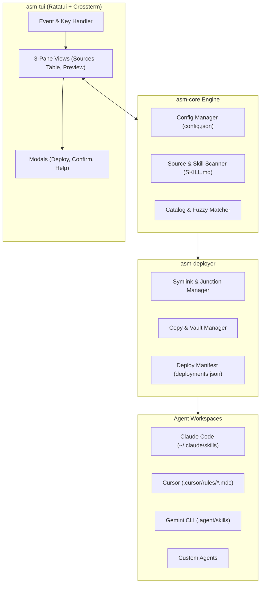

# Universal AI Agent Skill Manager (`asm`)

<div align="center">

[](https://www.rust-lang.org)
[](https://github.com/ratatui/ratatui)
[](LICENSE)
[]()

**A fast, native terminal tool to manage, inspect, and deploy AI coding agent skills across Claude Code, Cursor, Gemini CLI, and custom agents globally or per project.**

</div>

---

## 🖥️ Terminal Interface Preview

```text
┌─ [asm] Universal AI Agent Skill Manager ─────────── Project: ~/my-project ──────────┐
│                                                                                     │
│  SOURCES [Tab]      SKILLS LIST [Space: select, a: deploy, d: toggle]  PREVIEW [F1] │
│ ┌────────────────┐ ┌─────────────────────────────────────────────────┐ ┌──────────┐ │
│ │ > All Sources  │ │ [x] git-commit      official   Global   [Symlink]│ │# Commit  │ │
│ │   official     │ │ [ ] code-reviewer   official   Project  [Copy]   │ │Automates │ │
│ │   team-rules   │ │ [ ] sql-optimizer   team-rules Disabled [Symlink]│ │semantic  │ │
│ │   local-custom │ │ [ ] rust-audit      local-cust --       --       │ │commits...│ │
│ └────────────────┘ └─────────────────────────────────────────────────┘ └──────────┘ │
│  Search: [/] conventional commit...                                                 │
├─────────────────────────────────────────────────────────────────────────────────────┤
│  [?] Help  [/] Search  [Space] Select  [a] Deploy  [d] Toggle  [r] Remove  [q] Quit │
└─────────────────────────────────────────────────────────────────────────────────────┘
```

---

## 💡 Why `asm`?

As developers use multiple AI coding agents across projects (such as **Claude Code**, **Cursor**, **Gemini CLI / Antigravity**, and **Aider**), managing prompt skills, rulebooks, and agent instructions becomes increasingly fragmented:
- **Format Discrepancies**: Cursor prefers `.cursor/rules/*.mdc`, Claude Code uses `.claude/skills/`, while Gemini uses `.agent/skills/`.
- **Sync Drift**: Updating a skill in one project doesn't sync across your other projects or upstream Git repositories.
- **Dirty Agent Workspaces**: Renaming disabled skills to `.disabled` often triggers warnings in agent file watchers.

**`asm` solves this by providing a single, lightning-fast Terminal Dashboard**:
1. Connect multiple skill sources (local directories, local git repositories, remote GitHub/GitLab repos).
2. Interactively preview, fuzzy-search, and select skills.
3. Deploy skills via **Live Symlinks** (for instant upstream synchronization) or **Copies** (for isolated snapshots) globally or per-project.
4. Seamlessly toggle skills on/off without polluting your codebase.

---

## ✨ Features

- ⚡ **Pure Rust Performance**: Single static binary, zero runtime dependencies, instant boot, and sub-millisecond fuzzy search.
- 🧩 **Decoupled Agent Registry via `config.json`**: No hardcoded agent paths. Pre-configured for Claude Code, Cursor, and Gemini CLI, and easily extensible for any custom agent.
- 🔗 **Symlink & Copy Modes**:
  - **Symlink Mode**: Upstream edits and `git pull`s reflect instantly in agent workspaces.
  - **Copy Mode**: Creates an isolated, standalone snapshot for portability.
  - **Windows Junction Support**: Automatic fallback to directory junctions (`mklink /J`) or copies if running unprivileged on Windows.
- 🗂️ **Clean State Management**:
  - Enabling/disabling skills is tracked via `~/.config/asm/deployments.json`.
  - Disabling a symlink detaches it cleanly; disabling a copy safely moves it to a managed vault. Your agent directories remain 100% clean.
- 📖 **SKILL.md Metadata & Markdown Previewer**:
  - Full YAML frontmatter parser (`name`, `description`, `version`, `tags`, `author`).
  - Resilient fallback extracting titles and summaries from raw markdown headers.
  - Built-in syntax-highlighted markdown inspector with smooth scrolling.
- 🛡️ **Built-in Safety**:
  - Read-only protection for original source repositories.
  - Overwrite guards preventing accidental replacement of unmanaged files.
  - Broken symlink auto-healing.

---

## 🏗️ Architecture



---

## 🚀 Installation & Quick Start

### Prerequisites
* [Rust toolchain](https://www.rust-lang.org/tools/install) (1.80 or newer):
  ```bash
  curl --proto '=https' --tlsv1.2 -sSf https://sh.rustup.rs | sh
  ```

### Build from Source
```bash
# Clone the repository
git clone https://github.com/your-username/skill-management.git
cd skill-management

# Build the optimized release binary
cargo build --release

# Run asm
./target/release/asm
```

### Optional: Install Globally
```bash
cargo install --path .
asm
```

### CLI Quick Commands

You can manage sources and install/remove skills directly from the command line or use the interactive TUI:

```bash
# 1. Add a remote Git source (Global by default; use --project for local project repo)
asm source add agent-engineering-skills https://github.com/thaihai-swe/Agent-Engineering-Skills
asm source add team-rules ./local-skills --project

# 2. List registered sources (shows Global vs Project scope)
asm source list

# 3. Synchronize remote sources (git pull)
asm source sync

# 4. Install a skill into project agents (.agents/skills, .claude/skills, etc.)
asm install coding-rules-generator

# 5. Install a skill globally (~/.agents/skills, ~/.claude/skills, etc.)
asm install prompt-optimizer --global

# 6. List skills installed in current project
asm list

# 7. List skills installed globally
asm list --global

# 8. List both project and global installed skills
asm list --all

# 9. Remove/delete a skill from the current project
asm remove coding-rules-generator

# 10. Remove/delete a skill from global agent directories
asm remove prompt-optimizer --global

# 11. Launch the interactive TUI dashboard
asm
```

---

## ⌨️ Keyboard Shortcuts & Controls

| Key | Context | Action |
| :--- | :--- | :--- |
| `+` / `n` / `F2` | Global / Any Pane | Open **Add Source Modal** (select Global or Project scope) |
| `Tab` / `BackTab` | Main Dashboard | Cycle active pane (**Sources Tree** ⇄ **Skills Table** ⇄ **Preview**) |
| `j` / `k` or `↓` / `↑` | Main Dashboard | Move cursor up / down in the active pane |
| `Space` | Skills Table | Toggle multi-select checkbox on the highlighted skill |
| `a` | Skills Table | Open **Deploy Modal** (select Mode, Scope, and Target Agents) |
| `d` | Skills Table | Toggle **Enable / Disable** status on selected skill(s) |
| `r` / `Delete` | Skills Table | **Delete skill** from Project (when in Project view) or Global (when in Global view) |
| `r` / `Delete` | Sources Pane | **Remove source** registry entry (prompts confirmation) |
| `s` | Main Dashboard | **Sync** remote Git sources (`git pull --ff-only` silently) |
| `/` | Main Dashboard | Activate live **Fuzzy Search** (matches name, description, tags, source) |
| `PageUp` / `PageDown` | Preview Pane | Scroll preview markdown up / down |
| `?` | Main Dashboard | Show keyboard shortcuts modal |
| `q` or `Ctrl+c` | Global | Exit application cleanly |

---

## ⚙️ Configuration Guide

### `~/.config/asm/config.json`
On first run, `asm` automatically creates your configuration file at `~/.config/asm/config.json` (or `%APPDATA%\asm\config.json` on Windows):

```json
{
  "version": 1,
  "settings": {
    "default_deployment_mode": "symlink",
    "confirm_destructive_actions": true,
    "sources_cache_dir": "~/.config/asm/sources",
    "theme": "default"
  },
  "agents": {
    "universal-agent": {
      "display_name": "Universal Agent (OpenAI Standard)",
      "enabled": true,
      "global_dir": "~/.agents/skills",
      "project_dir": ".agents/skills",
      "packaging": "directory",
      "target_file": "SKILL.md"
    },
    "claude-code": {
      "display_name": "Claude Code",
      "enabled": true,
      "global_dir": "~/.claude/skills",
      "project_dir": ".claude/skills",
      "packaging": "directory",
      "target_file": "SKILL.md"
    },
    "cursor": {
      "display_name": "Cursor",
      "enabled": true,
      "global_dir": "~/.cursor/rules",
      "project_dir": ".cursor/rules",
      "packaging": "file",
      "target_file": "{skill_name}.mdc"
    },
    "gemini-cli": {
      "display_name": "Gemini CLI / Antigravity",
      "enabled": true,
      "global_dir": "~/.gemini/antigravity-cli/skills",
      "project_dir": ".agent/skills",
      "packaging": "directory",
      "target_file": "SKILL.md"
    },
    "custom-agent": {
      "display_name": "My Custom Agent",
      "enabled": false,
      "global_dir": "~/.config/custom/skills",
      "project_dir": ".skills",
      "packaging": "directory",
      "target_file": "SKILL.md"
    }
  }
}
```

### Adding a New Agent
To support any other AI coding tool, simply add a new entry to the `agents` map in `config.json`:
- `packaging: "directory"`: Deploys the entire skill folder.
- `packaging: "file"`: Deploys the `SKILL.md` file renamed to `target_file` (e.g. `{skill_name}.mdc`).

---

## 📦 Authoring a Skill (`SKILL.md`)

`asm` recognizes any directory containing a `SKILL.md` file as a valid skill.

### Recommended: With YAML Frontmatter
```markdown
---
name: "git-commit"
description: "Generates semantic commit messages following conventional commits"
version: "1.0.0"
tags: ["git", "workflow", "productivity"]
author: "asm-team"
---
# Git Commit Assistant

Automates the creation of semantic commit messages.

## Guidelines
- Use `<type>(<scope>): <subject>` format.
```

### Minimal Fallback Format
If frontmatter is omitted, `asm` automatically parses the folder name as the skill name, the first `# Header` as the display title, and the leading paragraph as the description.

---

## 🧪 Testing

`asm` includes an automated test suite covering parser edge cases, configuration schemas, symlink/copy deployments, and state restoration:

```bash
# Run all tests
cargo test

# Run a specific integration test
cargo test --test test_deploy
```

---

## 📂 Project Structure

```text
skill-management/
├── Cargo.toml                  # Pinned dependencies (Ratatui, Crossterm, Serde)
├── README.md                   # Project documentation
├── fixtures/                   # Sample test skills
│   └── skills/
│       ├── git-commit/SKILL.md # Frontmatter-enabled skill fixture
│       └── code-review/SKILL.md# Header-fallback skill fixture
├── src/
│   ├── main.rs                 # Terminal setup, event loop, panic recovery hook
│   ├── lib.rs                  # Library crate root for integration testing
│   ├── config/                 # JSON configuration loader and agent schemas
│   ├── core/                   # Skill parser, scanner, source registry, and catalog
│   ├── deploy/                 # Symlink, copy, junction, and manifest controller
│   └── tui/                    # Ratatui application state, UI renderer, and modals
└── tests/                      # Integration test suites
```

---

## 📄 License

This project is licensed under the [MIT License](LICENSE).
