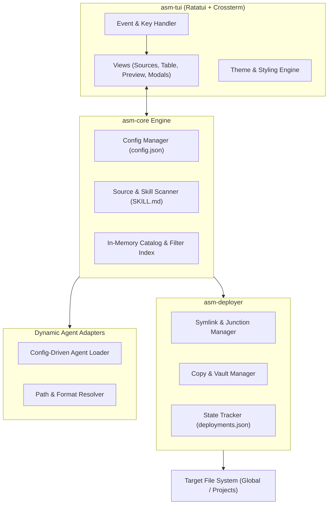

# Universal AI Agent Skill Manager (`asm`)
## Software Requirements Specification (SRS) & Architecture

**Product Name:** Universal AI Agent Skill Manager (`asm`)  
**Technology Stack:** Pure **Rust** with an **Interactive Terminal UI (TUI)** (`ratatui` + `crossterm`)  
**Goal:** A fast, native, cross-platform terminal tool to manage agent skills from diverse sources (local directories, Git repositories) and deploy/toggle them across AI coding agents globally or per project.

---

## 1. System Overview & Core Principles

1. **Pure Rust Architecture**: Implemented as a single, self-contained binary with zero external runtime dependencies.
2. **Terminal-First UX**: Dedicated full-screen interactive Terminal User Interface (TUI) with responsive keyboard navigation, instant live filtering, and syntax-highlighted markdown previews.
3. **Decoupled Agent Registry via JSON Configuration**: Supported agents and their filesystem conventions are **not hardcoded**. They are initialized with sensible defaults into a user-editable JSON configuration file (`~/.config/asm/config.json`), allowing seamless addition of custom or newly emerging AI agents.
4. **User-Controlled Deployment Modes**: The user explicitly chooses between **Symlink Mode** (real-time upstream sync) and **Copy Mode** (independent, isolated snapshots), with automatic Windows junction fallbacks.
5. **Non-Destructive State Management**: Enabling and disabling skills is tracked via a clean manifest file (`deployments.json`), ensuring target agent directories are never polluted with renamed files (e.g., `.disabled` extensions).

---

## 2. Skill Source Management

`asm` aggregates skills from multiple local and remote origins into a unified catalog.

### Requirements:
* **Source Types Supported**:
  * **Local Folders**: Absolute or relative directories containing one or more skill packages.
  * **Local Git Repositories**: Local git working copies.
  * **Remote Git Repositories**: Public or authenticated Git repositories over HTTPS/SSH (e.g., GitHub, GitLab). Remote sources are cached locally under `~/.config/asm/sources/<source-alias>/`.
* **Source Operations**:
  * Register new sources with a human-readable alias (e.g., `official`, `community`, `team-playbooks`).
  * Enable, disable, or unregister sources without touching the underlying filesystem.
  * Fetch/Sync remote Git sources on demand or on TUI launch (`git fetch` / `git pull --ff-only`).
* **Automated Skill Discovery**:
  * Recursively scan registered sources for skill packages.
  * Marker standard: Any directory containing a `SKILL.md` file is recognized as a valid skill.
  * Scan exclusion: Automatically ignore standard dependency/build directories (`.git`, `node_modules`, `target`, `dist`, `.venv`, `vendor`) and honor optional `.skillignore` files.

---

## 3. Skill Library & Metadata Engine

A centralized in-memory catalog indexed across all active sources.

### Requirements:
* **Metadata Extraction Standard**:
  * Extract metadata from YAML frontmatter in `SKILL.md`:
    ```yaml
    ---
    name: "smart-git-commit"
    description: "Generates semantic commit messages following conventional commits"
    version: "1.2.0"
    tags: ["git", "workflow", "productivity"]
    author: "ai-team"
    ---
    ```
  * **Graceful Fallback**: If YAML frontmatter is absent:
    * `name`: Derived from the folder name.
    * `description`: Extracted from the first `# Header` and leading paragraph.
* **Namespacing & Conflict Resolution**:
  * Skills with identical names across different sources are automatically disambiguated using the format `<source-alias>/<skill-name>` (e.g., `official/commit` vs `my-fork/commit`).
* **Search & Filter**:
  * Real-time fuzzy search by skill name, description, tags, or source.
  * Filter by deployment status: All, Deployed (Global), Deployed (Project), Unused, Disabled.
* **Inspector & Markdown Preview**:
  * Full syntax-highlighted rendering of `SKILL.md` within the TUI right-hand preview panel with smooth line-by-line scrolling.
* **Installed State Detection**:
  * Automatically scans the current working directory and global paths to detect pre-existing skills, whether managed by `asm` or installed manually.

---

## 4. Multi-Agent Configuration (`config.json`)

To prevent agent lock-in and accommodate rapid changes in AI tooling, all agent directory conventions, file structures, and packaging strategies are externalized into a JSON configuration file.

### Configuration Lifecycle:
1. **First-run Initialization**: On first launch, `asm` generates `~/.config/asm/config.json` populated with default adapters for popular agents.
2. **User Customization**: Users can edit paths, toggle agents, modify file naming formats, or register entirely new agents directly in the JSON file.

### Default Configuration Schema:
```json
{
  "$schema": "https://raw.githubusercontent.com/universal-agent-skill-manager/asm/main/schema/config.schema.json",
  "version": 1,
  "settings": {
    "default_deployment_mode": "symlink",
    "confirm_destructive_actions": true,
    "sources_cache_dir": "~/.config/asm/sources",
    "theme": "default"
  },
  "agents": {
    "universal-agent": {
      "display_name": "Universal Agent (OpenAI Standard)",
      "enabled": true,
      "global_dir": "~/.agents/skills",
      "project_dir": ".agents/skills",
      "packaging": "directory",
      "target_file": "SKILL.md"
    },
    "claude-code": {
      "display_name": "Claude Code",
      "enabled": true,
      "global_dir": "~/.claude/skills",
      "project_dir": ".claude/skills",
      "packaging": "directory",
      "target_file": "SKILL.md"
    },
    "cursor": {
      "display_name": "Cursor",
      "enabled": true,
      "global_dir": "~/.cursor/rules",
      "project_dir": ".cursor/rules",
      "packaging": "file",
      "target_file": "{skill_name}.mdc"
    },
    "gemini-cli": {
      "display_name": "Gemini CLI / Antigravity",
      "enabled": true,
      "global_dir": "~/.gemini/antigravity-cli/skills",
      "project_dir": ".agent/skills",
      "packaging": "directory",
      "target_file": "SKILL.md"
    },
    "custom-agent": {
      "display_name": "Custom Agent",
      "enabled": false,
      "global_dir": "~/.config/custom-agent/skills",
      "project_dir": ".skills",
      "packaging": "directory",
      "target_file": "SKILL.md"
    }
  }
}
```

### Dynamic Detection:
* On startup, `asm` verifies the presence of each agent's global directory or binary to highlight active agents in the UI.

---

## 5. Skill Deployment Engine

Provides fine-grained control over how and where skills are linked or copied.

### Requirements:
* **Interactive Deployment Flow**:
  1. User selects one or multiple skills in the TUI table.
  2. User invokes Deploy action (`<a>` key).
  3. Interactive dialog prompts the user to select:
     * **Deployment Mode**:
       * **Symlink** (`ln -s` / directory junction): Synchronizes changes made in the source directly to the agent.
       * **Copy**: Creates an independent snapshot of the skill directory/file.
     * **Target Scope**:
       * `Global`: Deploys to agent global directories (e.g., `~/.claude/skills/`).
       * `Current Project`: Deploys to the active project folder (e.g., `./.claude/skills/`).
       * `Selected Project`: Opens an interactive directory browser to select any workspace root.
     * **Target Agents**: Checkbox list of enabled agents (deploy to one, several, or all active agents at once).
  4. Confirmation dialog showing source paths, destination paths, and potential collision alerts.
* **Scope Migration & Synchronization**:
  * Copy/promote skills from `Global -> Project`.
  * Copy/promote skills from `Project -> Global`.
  * Clone skills from `Project -> Project`.
* **Removal**:
  * Clean unlinking/deletion of deployed skills with explicit user confirmation (`<r>` key).

---

## 6. Skill Enable / Disable State Management

Enables users to temporarily activate or deactivate skills without deleting files or losing configurations.

### Requirements:
* **Manifest-Driven State Engine**:
  * Managed via `~/.config/asm/deployments.json` for global installations and `<project_root>/.asm-project.json` for project-specific installations.
* **Non-Destructive Toggle Logic**:
  * **When Enabled**: The symlink or copied directory resides in the active agent directory.
  * **When Disabled**:
    * For **Symlinks**: The symlink is removed from the target directory, but the registry retains its configuration, source mapping, and target metadata.
    * For **Copies**: The file/directory is safely moved to an internal staging vault (`~/.config/asm/vault/` or `.asm/vault/`) rather than being deleted or renamed with dirty `.disabled` extensions.
  * **When Re-enabled**: Restored immediately to the target agent directory.
* **Independent Scopes**:
  * Enabling or disabling a global skill does not affect project-level overrides, and vice versa.
* **Bulk Toggling**:
  * Toggle all selected skills with a single keystroke (`<d>`).

---

## 7. Interactive Terminal User Interface (TUI)

Built exclusively in Rust with `ratatui` and `crossterm` for maximum responsiveness and native cross-platform terminal rendering.

### TUI Layout Specification:

```
┌─ [asm] Universal AI Agent Skill Manager ─────────── Project: ~/Desktop/my-project ──┐
│                                                                                     │
│  SOURCES [Tab]      SKILLS LIST [Space: select, a: deploy, d: toggle]  PREVIEW [F1] │
│ ┌────────────────┐ ┌─────────────────────────────────────────────────┐ ┌──────────┐ │
│ │ > All Sources  │ │ [x] git-commit      official   Global   [Symlink]│ │# Commit  │ │
│ │   official     │ │ [ ] code-reviewer   official   Project  [Copy]   │ │Automates │ │
│ │   team-rules   │ │ [ ] sql-optimizer   team-rules Disabled [Symlink]│ │semantic  │ │
│ │   local-custom │ │ [ ] rust-audit      local-cust --       --       │ │commits...│ │
│ │                │ │                                                 │ │          │ │
│ └────────────────┘ └─────────────────────────────────────────────────┘ └──────────┘ │
│  Search: [/] conventional commit...                                                 │
├─────────────────────────────────────────────────────────────────────────────────────┤
│  [?] Help  [/] Search  [Space] Select  [a] Deploy  [d] Toggle  [r] Remove  [q] Quit │
└─────────────────────────────────────────────────────────────────────────────────────┘
```

### Interaction & Keybindings:
* **Navigation**:
  * `Tab` / `Shift+Tab`: Cycle active focus across Panes (Sources Tree ⇄ Skills Table ⇄ Preview Pane).
  * `j` / `k` or `Up` / `Down`: Move selection within the active pane.
  * `PageUp` / `PageDown` or `Ctrl+u` / `Ctrl+d`: Scroll preview markdown.
* **Selection & Actions**:
  * `Space`: Toggle multi-selection on highlighted skill.
  * `Enter`: Open details / inspection view.
  * `a`: Open **Deploy Modal** (select mode: Symlink/Copy, scope: Global/Project, target agents).
  * `d`: Toggle Enable / Disable state for selected skill(s).
  * `r`: Remove / Undeploy selected skill(s) (with confirmation dialog).
  * `s`: Sync remote sources (`git fetch` / `pull`).
  * `/`: Enter live filter/search query; `Esc` to clear.
  * `q` or `Ctrl+c`: Exit application cleanly.

---

## 8. Basic Safety & Cross-Platform Configuration

### Safety Guarantees:
1. **Source Protection**: Source directories and original repositories are strictly treated as read-only during all deployment operations.
2. **Accidental Overwrite Prevention**:
   * If a target file already exists and was not deployed by `asm` (i.e. unmanaged), `asm` prompts with a non-destructive warning: `Abort`, `Backup & Overwrite`, or `Skip`.
3. **Broken Symlink Auto-Healing**:
   * If an upstream source directory is moved or deleted, `asm` flags broken symlinks with an alert indicator (`[!] Broken Link`) and provides an automatic cleanup or repointing command.
4. **Operation Confirmations**:
   * All irreversible actions (unlinking, deleting copies, bulk disable) present a confirmation dialog detailing affected paths.

### Cross-Platform Standards:
* **Paths & XDG Standards**:
  * **macOS / Linux**: Configuration stored in `$XDG_CONFIG_HOME/asm` or `~/.config/asm/`. Data cache in `~/.cache/asm/` or `$XDG_CACHE_HOME/asm`.
  * **Windows**: Configuration stored in `%APPDATA%\asm\`. Data cache in `%LOCALAPPDATA%\asm\`.
* **Windows Symlink / Junction Support**:
  * Standard symlinks on Windows require elevated permissions or Windows Developer Mode.
  * When running without elevation on Windows, `asm` automatically falls back to **Directory Junctions** (`mklink /J`) for folder links, or switches seamlessly to **Copy Mode** if junctions are unsupported.

---

## 9. Proposed Rust Architecture & Roadmap

### Module & Crate Architecture:



### Proposed Crate Structure:
```text
asm/
├── Cargo.toml
├── src/
│   ├── main.rs                   # Entry point, terminal initialization, panic hook
│   ├── app.rs                    # Central application state & action dispatcher
│   ├── config/
│   │   ├── mod.rs                # Config loader & serializer
│   │   ├── schema.rs             # Config & Agent JSON data models
│   │   └── defaults.rs           # Embedded default config.json
│   ├── core/
│   │   ├── skill.rs              # Skill struct, frontmatter parser, fallback logic
│   │   ├── source.rs             # Local & Git source fetcher / scanner
│   │   └── catalog.rs            # In-memory index, search, and filter engine
│   ├── deploy/
│   │   ├── mod.rs                # Deployment controller (Deploy, Undeploy, Toggle)
│   │   ├── fs_ops.rs             # Cross-platform symlink, junction, and copy routines
│   │   └── manifest.rs           # deployments.json and .asm-project.json tracker
│   └── tui/
│       ├── mod.rs                # Ratatui terminal setup & event loop
│       ├── ui.rs                 # Layout builder & widget renderer
│       ├── components/           # Pane widgets (sources, table, preview, search)
│       └── modals/               # Dialogs (deploy options, confirmation, errors)
```

### Phased Implementation Roadmap:

* **Phase 1: Foundations & Config Engine**
  * Project setup with Rust, `ratatui`, `crossterm`, `serde`, `serde_json`, `walkdir`.
  * Configuration loader with default `config.json` initialization.
  * Local and Git source scanner with `SKILL.md` frontmatter parser and fallbacks.
* **Phase 2: Deployment & State Core**
  * Symlink, junction, and copy implementations with Windows safety checks.
  * State tracking with `deployments.json`.
  * Non-destructive enable/disable toggle engine.
* **Phase 3: Interactive TUI Dashboard**
  * Three-pane layout (Sources, Skills Table, Markdown Preview).
  * Interactive Deploy modal (Symlink vs Copy, Global vs Project, Agent checklist).
  * Search/filter bar and keyboard navigation.
* **Phase 4: Safety & Polish**
  * Broken symlink detection and repair dialog.
  * Overwrite conflict resolution.
  * Cross-platform testing on macOS, Linux, and Windows.
